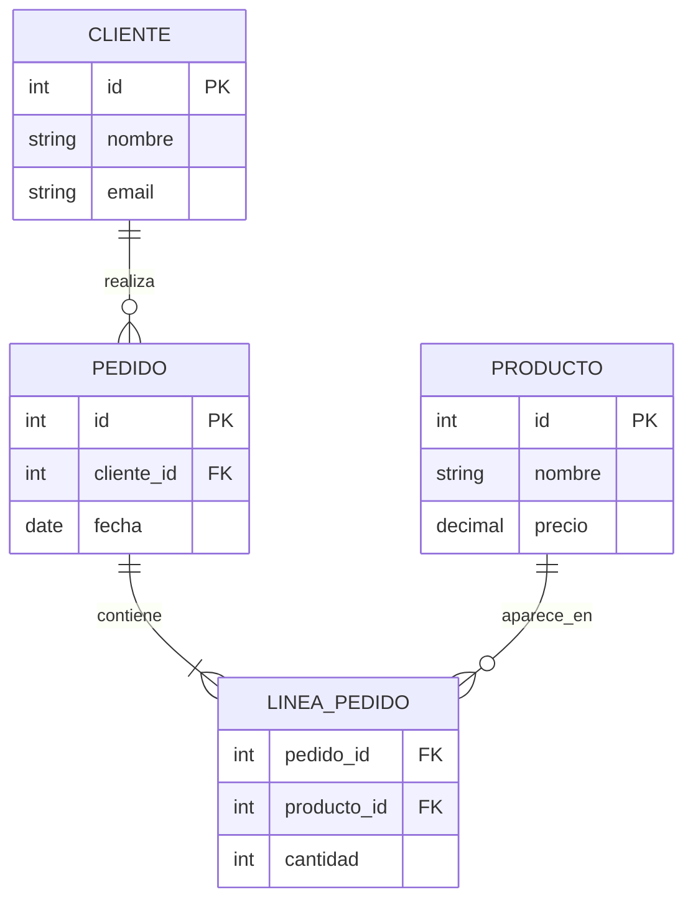

# 03 - Modelo Relacional

## 🎯 Objetivos
- Entender tablas, filas y columnas
- Conocer claves primarias y foráneas
- Leer un diagrama entidad-relación

## 📚 Conceptos clave

### Tabla (relación)
Estructura que organiza datos en **filas** y **columnas**.

```
┌────┬──────────┬─────────┬──────────┐
│ id │ nombre   │ email   │ edad     │
├────┼──────────┼─────────┼──────────┤
│ 1  │ Ana      │ a@x.com │ 25       │
│ 2  │ Luis     │ l@x.com │ 30       │
│ 3  │ Marta    │ m@x.com │ 28       │
└────┴──────────┴─────────┴──────────┘
```

- **Fila (registro/tupla):** cada entrada completa (Ana, Luis...)
- **Columna (campo/atributo):** cada categoría (id, nombre...)
- **Celda:** intersección fila-columna

### Clave primaria (Primary Key - PK)
Columna(s) que identifican **úniquamente** cada fila.
- No puede ser NULL
- No puede repetirse
- Normalmente es `id`

### Clave foránea (Foreign Key - FK)
Columna que **referencia** la PK de otra tabla. Crea la relación.

### Ejemplo de relación

```
CLIENTES                    PEDIDOS
┌────┬────────┐            ┌────┬─────────────┬────────┐
│ id │ nombre │            │ id │ cliente_id  │ total  │
├────┼────────┤            ├────┼─────────────┼────────┤
│ 1  │ Ana    │◄───────────│ 1  │ 1           │ 150    │
│ 2  │ Luis   │            │ 2  │ 1           │ 200    │
└────┴────────┘            │ 3  │ 2           │ 80     │
                           └────┴─────────────┴────────┘
```

- `clientes.id` es **PK**
- `pedidos.cliente_id` es **FK** que apunta a `clientes.id`
- Un cliente puede tener **muchos** pedidos → relación **1 a N**

### Tipos de relaciones
| Relación | Ejemplo |
|----------|---------|
| 1 a 1 | Usuario ↔ Perfil |
| 1 a N | Cliente → Pedidos |
| N a M | Estudiantes ↔ Cursos (requiere tabla intermedia) |

### Diagrama Entidad-Relación (ER)



## 💻 Ejemplo en SQL

```sql
CREATE TABLE clientes (
    id SERIAL PRIMARY KEY,
    nombre VARCHAR(100) NOT NULL,
    email VARCHAR(150) UNIQUE NOT NULL
);

CREATE TABLE pedidos (
    id SERIAL PRIMARY KEY,
    cliente_id INT NOT NULL,
    fecha DATE DEFAULT CURRENT_DATE,
    total DECIMAL(10,2),
    FOREIGN KEY (cliente_id) REFERENCES clientes(id)
);
```

## 🔑 Reglas de oro
1. Toda tabla debe tener una **PK**
2. Las **FK** garantizan integridad referencial
3. No repitas información (principio de normalización, lo veremos en el módulo 05)
4. Piensa primero el modelo, luego escribe SQL

## ⚠️ Errores comunes
- Olvidar definir la PK
- Guardar el nombre del cliente en `pedidos` en lugar del `cliente_id` (duplicación)
- No declarar la FK (pierdes integridad)

## ✅ Ejercicios
1. Diseña las tablas para un sistema de biblioteca: libros, autores, préstamos
2. Identifica PK y FK en cada tabla
3. ¿Qué tipo de relación hay entre autor y libro?
4. Dibuja el diagrama ER

## 🔗 Recursos
- [Modelo relacional - Wikipedia](https://es.wikipedia.org/wiki/Modelo_relacional)
- [dbdiagram.io](https://dbdiagram.io/) - para dibujar diagramas ER gratis