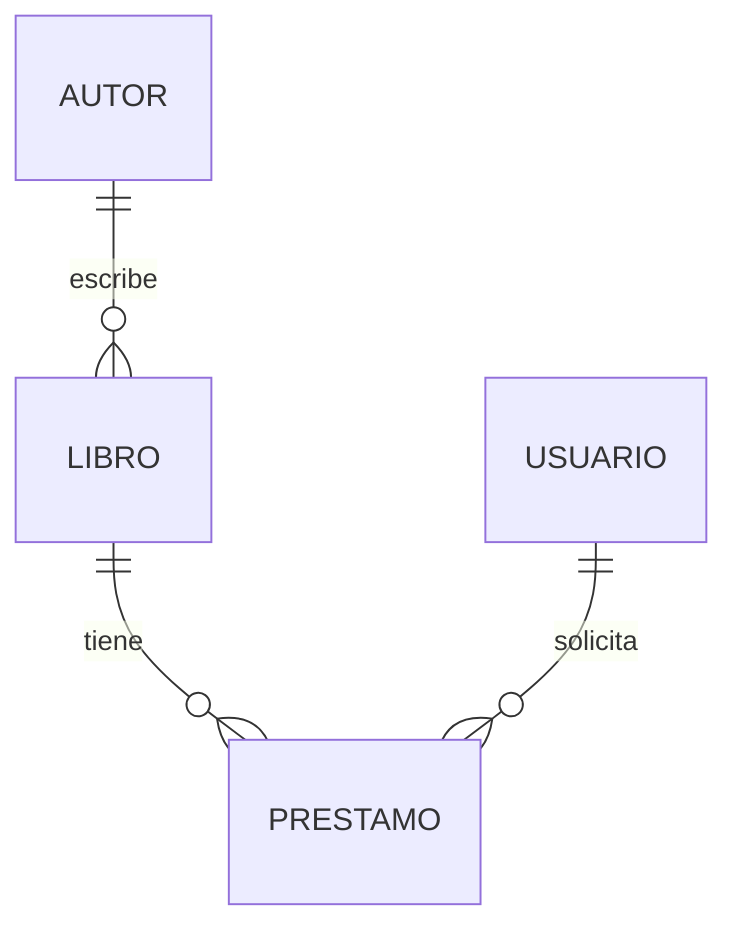

# 🧪 Ejercicios - Módulo 01: Fundamentos

## Nivel 🟢 Fácil

### Ejercicio 1
Define con tus palabras:
- Dato
- Información
- Base de datos
- SGBD

<details>
<summary>💡 Ver solución</summary>

- **Dato:** valor sin contexto (ej: `42`)
- **Información:** dato con contexto (ej: "la respuesta es 42")
- **Base de datos:** colección organizada de datos almacenados y consultables
- **SGBD:** software que administra la base de datos (PostgreSQL, MySQL...)

</details>

### Ejercicio 2
Clasifica como SQL o NoSQL:
1. PostgreSQL
2. MongoDB
3. Redis
4. MySQL
5. Neo4j
6. SQLite

<details>
<summary>💡 Ver solución</summary>

| BD | Tipo |
|----|------|
| PostgreSQL | SQL |
| MongoDB | NoSQL (documental) |
| Redis | NoSQL (clave-valor) |
| MySQL | SQL |
| Neo4j | NoSQL (grafos) |
| SQLite | SQL |

</details>

---

## Nivel 🟡 Intermedio

### Ejercicio 3
Diseña las tablas necesarias para una **app de música** (tipo Spotify) con:
- Usuarios
- Canciones
- Artistas
- Playlists

Indica PK y FK de cada tabla.

<details>
<summary>💡 Ver solución</summary>

```
USUARIOS(id PK, nombre, email)
ARTISTAS(id PK, nombre, pais)
CANCIONES(id PK, titulo, duracion, artista_id FK → ARTISTAS.id)
PLAYLISTS(id PK, nombre, usuario_id FK → USUARIOS.id)
PLAYLIST_CANCIONES(playlist_id FK, cancion_id FK, orden)
```

Relaciones:
- Artista 1→N Canciones
- Usuario 1→N Playlists
- Playlist N→M Canciones (tabla intermedia)

</details>

### Ejercicio 4
Observa este diagrama y responde:



a) ¿Puede un libro tener varios autores?  
b) ¿Puede un usuario tener varios préstamos activos?  
c) ¿Qué representa la tabla PRESTAMO?

<details>
<summary>💡 Ver solución</summary>

a) No con este diseño (relación 1→N). Habría que cambiar a N→M  
b) Sí, la relación es 1→N  
c) La relación entre libros y usuarios: quién pidió qué libro y cuándo

</details>

---

## Nivel 🔴 Difícil

### Ejercicio 5
Una universidad necesita gestionar:
- Estudiantes (pueden estar en varios cursos)
- Cursos (pueden tener varios estudiantes)
- Profesores (un curso puede tener varios profesores)
- Notas (un estudiante tiene una nota por curso)

Diseña el modelo completo con todas las tablas, PK, FK y relaciones. Justifica cada decisión.

<details>
<summary>💡 Ver solución</summary>

```
ESTUDIANTES(id PK, nombre, matricula UNIQUE, email)
PROFESORES(id PK, nombre, departamento)
CURSOS(id PK, nombre, creditos, semestre)
CURSO_PROFESOR(curso_id FK, profesor_id FK) -- N:M
INSCRIPCIONES(estudiante_id FK, curso_id FK, nota, fecha) -- N:M con atributo extra
```

Razones:
- CURSO_PROFESOR permite varios profesores por curso (N:M)
- INSCRIPCIONES resuelve N:M estudiante↔curso y añade `nota` y `fecha`
- La nota vive en la inscripción porque depende de la combinación estudiante+curso

</details>

### Ejercicio 6 (investigación)
Busca y explica:
1. ¿Qué son las propiedades ACID?
2. ¿Qué es el teorema CAP?
3. ¿Cuándo preferirías consistencia eventual sobre consistencia fuerte?

<details>
<summary>💡 Pistas</summary>

- **ACID:** Atomicity, Consistency, Isolation, Durability
- **CAP:** Consistency, Availability, Partition tolerance (solo puedes garantizar 2 de 3)
- **Eventual:** sistemas distribuidos donde la disponibilidad importa más que la consistencia inmediata (ej: feeds de redes sociales)

</details>

---

## 🎯 Autoevaluación

Marca lo que ya dominas:
- [ ] Diferencio dato de información
- [ ] Sé qué es un SGBD y ejemplos
- [ ] Distingo SQL de NoSQL
- [ ] Identifico PK y FK
- [ ] Reconozco relaciones 1:1, 1:N, N:M
- [ ] Puedo leer un diagrama ER
- [ ] Puedo diseñar tablas para un caso simple