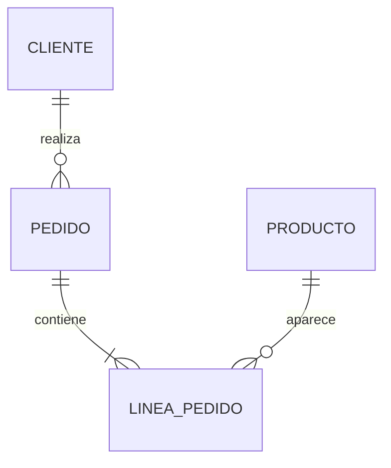
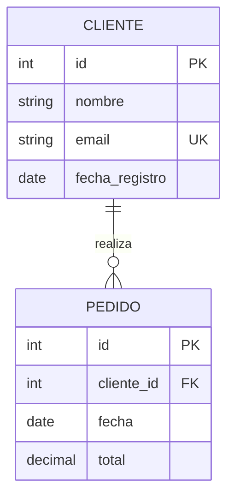
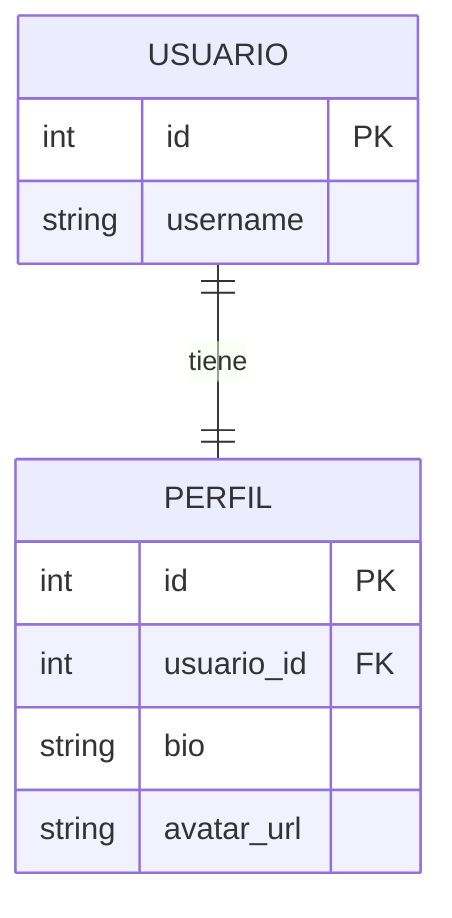
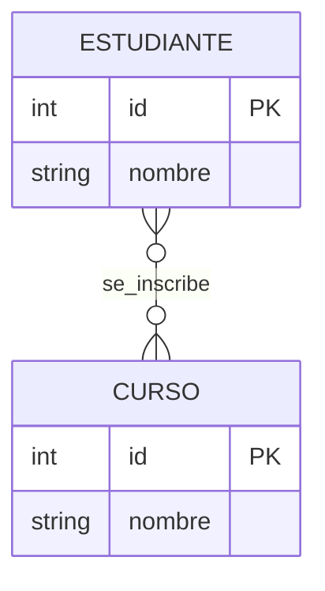
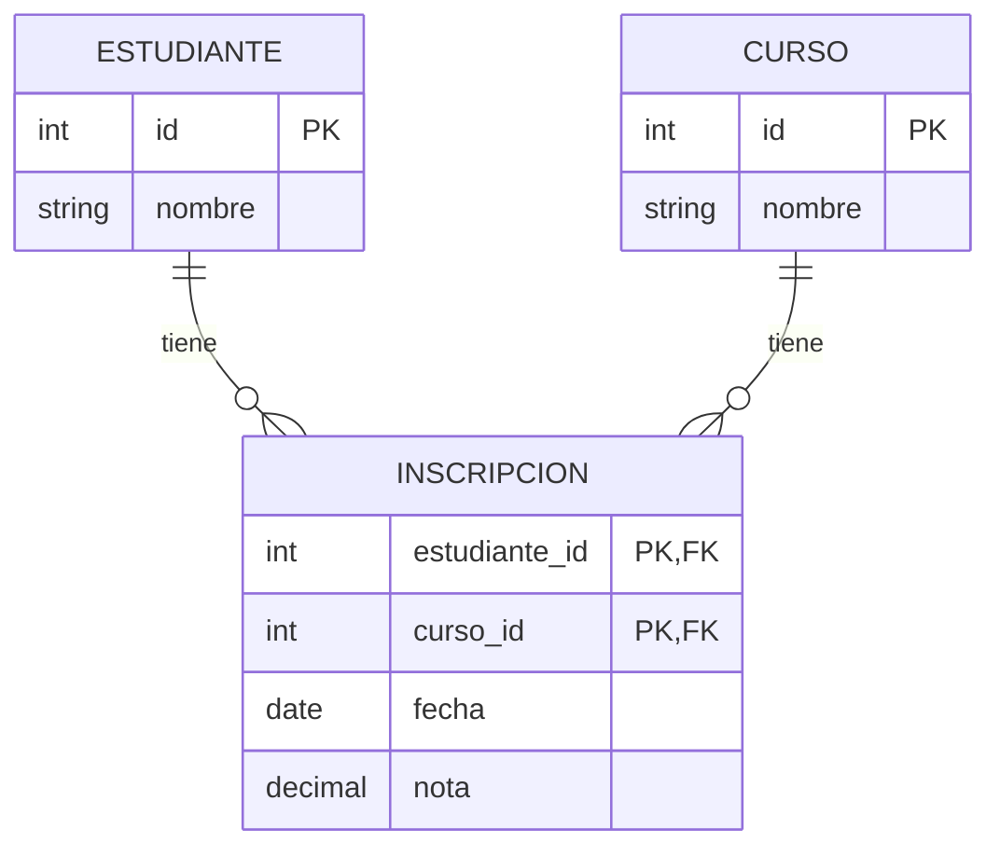
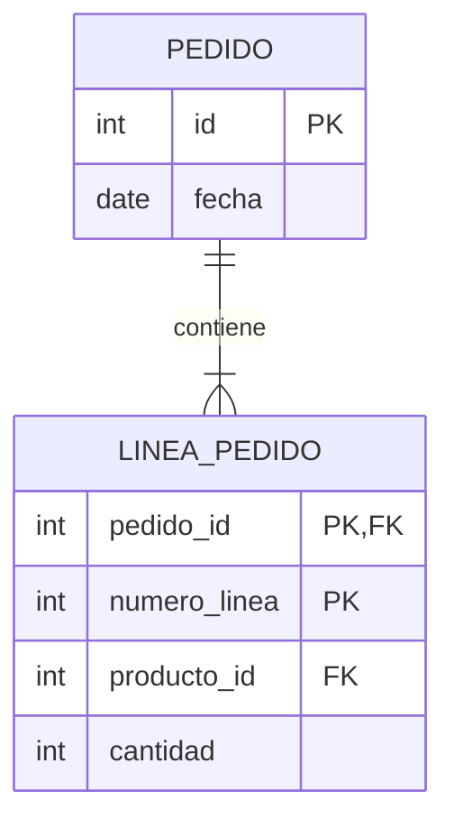
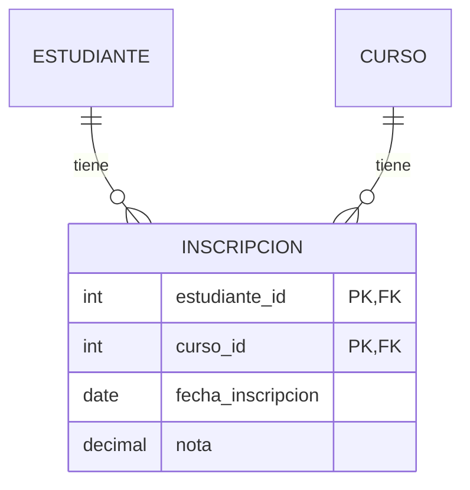
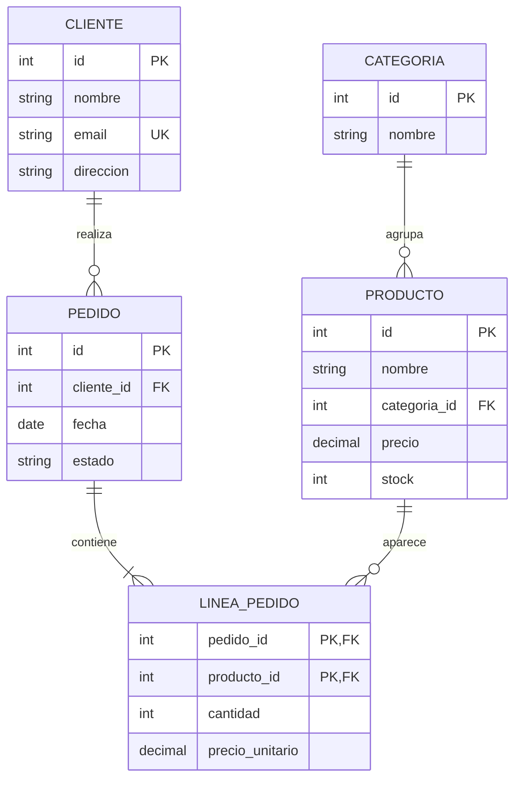

# 02 - Diagramas Entidad-Relación

## 🎯 Objetivos

- Conocer la notación de diagramas ER
- Diferenciar los tipos de cardinalidad
- Representar entidades débiles
- Leer y crear diagramas ER en Mermaid

## 📚 ¿Qué es un diagrama ER?

Representación visual de entidades, atributos y relaciones. Es el **plano** de la BD.

## 🎨 Notaciones

| Notación | Uso |
|----------|-----|
| Chen | Académica, con rombos y óvalos |
| Crow's Foot (pata de gallo) | La más usada en la industria |
| UML | Orientada a objetos |
| Mermaid | Diagramas en texto (útil para Markdown) |

Aquí usaremos **Crow's Foot** y **Mermaid** (compatible con GitHub).

## 📊 Símbolos Crow's Foot

```
───||  Uno y solo uno
───o|  Cero o uno
───|{  Uno o muchos
───o{  Cero o muchos
```

### Ejemplos

| Símbolo | Significado |
|---------|-------------|
| `||──||` | 1 a 1 |
| `||──o{` | 1 a N (opcional) |
| `||──|{` | 1 a N (obligatorio) |
| `}o──o{` | N a M |

## 💻 Mermaid: sintaxis básica



**Resultado visual:**


## 💻 Añadir atributos



**Resultado:**


### Marcadores de atributos

| Marcador | Significado |
|----------|-------------|
| `PK` | Primary Key |
| `FK` | Foreign Key |
| `UK` | Unique Key |

## 💻 Relación 1:1



**Cuándo:** cuando quieres separar datos (ej: por seguridad o frecuencia de uso).

## 💻 Relación N:M



**Cómo se implementa:** con tabla intermedia.



## 📚 Entidades débiles

Entidad que **no puede existir sin otra**.

**Ejemplo:** una línea de pedido no existe sin el pedido.



La PK de `LINEA_PEDIDO` es compuesta: `(pedido_id, numero_linea)`.

## 📚 Relaciones con atributos

Una relación N:M puede tener sus propios atributos.

**Ejemplo:** un estudiante se inscribe en un curso en una fecha y obtiene una nota.



## 🎯 Ejemplo completo: e-commerce



## 🛠️ Herramientas recomendadas

| Herramienta | Uso |
|-------------|-----|
| [dbdiagram.io](https://dbdiagram.io/) | Rápido y gratis, exporta a SQL |
| [draw.io](https://app.diagrams.net/) | Diagramas genéricos |
| [Mermaid Live](https://mermaid.live/) | Probar diagramas Mermaid |
| [DBeaver](https://dbeaver.io/) | Cliente BD con ER integrado |

## 💡 Cómo diseñar paso a paso

1. **Lista entidades** (sustantivos clave)
2. **Lista atributos** de cada una
3. **Identifica la PK** de cada entidad
4. **Dibuja relaciones** entre entidades
5. **Define cardinalidades** (1:1, 1:N, N:M)
6. **Resuelve N:M** con tablas intermedias
7. **Revisa**: ¿hay datos duplicados? ¿faltan relaciones?

## ⚠️ Errores comunes

- Confundir `1:N` con `N:1` (mira la dirección)
- Olvidar resolver N:M con tabla intermedia
- No marcar PK/FK en el diagrama
- Poner atributos que pertenecen a otra entidad
- Diagramas tan grandes que no se entienden

## ✅ Ejercicios

1. Dibuja el ER de una red social (usuarios, posts, likes, comentarios)
2. Dibuja el ER de una biblioteca (libros, autores, socios, préstamos)
3. Dibuja el ER de un sistema de facturación (clientes, facturas, líneas)
4. Convierte el ER de la red social a SQL
5. Identifica la entidad débil en un sistema de pedidos y explica por qué

## 🔗 Recursos

- [dbdiagram.io](https://dbdiagram.io/)
- [Mermaid ER](https://mermaid.js.org/syntax/entityRelationshipDiagram.html)