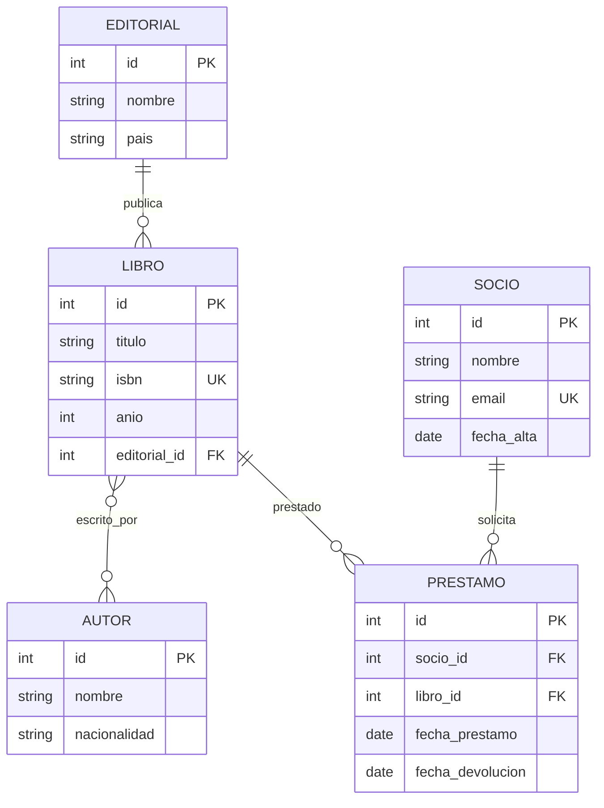
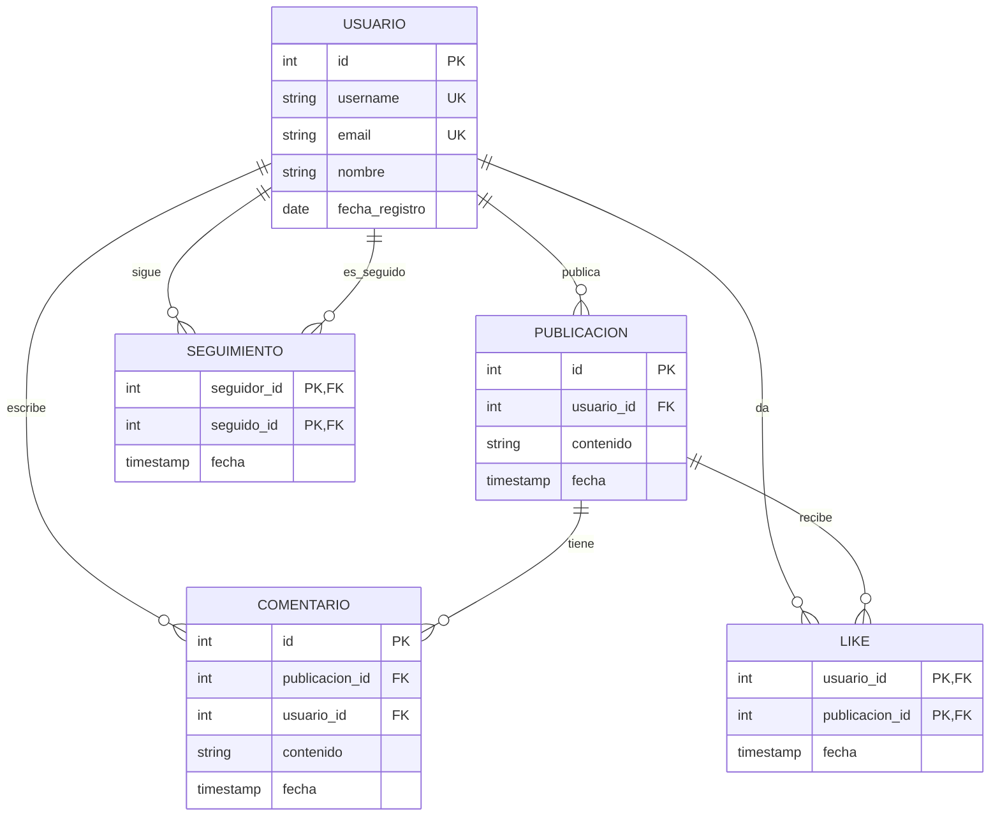
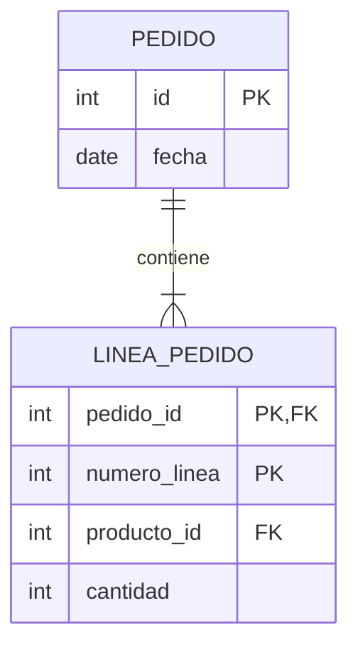

# 🧪 Ejercicios - Diseño y Diagramas ER

## Nivel 🟢 Fácil

### 1. Entidades y atributos
Identifica entidades y atributos para una app de **tareas** (tipo Todoist).

<details>
<summary>💡 Solución</summary>

**Entidades:**
- Usuario (id, nombre, email, password_hash)
- Proyecto (id, nombre, color, usuario_id)
- Tarea (id, titulo, descripcion, completada, fecha_limite, proyecto_id)
- Etiqueta (id, nombre, color)
- Tarea_Etiqueta (tarea_id, etiqueta_id)

**Relaciones:**
- Usuario 1:N Proyecto
- Proyecto 1:N Tarea
- Tarea N:M Etiqueta

</details>

### 2. Cardinalidades
¿Qué cardinalidad tienen estas relaciones?

a) Usuario ↔ Perfil  
b) Cliente → Pedido  
c) Estudiante ↔ Curso  
d) País → Ciudad

<details>
<summary>💡 Solución</summary>

a) 1:1  
b) 1:N  
c) N:M  
d) 1:N

</details>

---

## Nivel 🟡 Intermedio

### 3. Diagrama ER de biblioteca
Diseña el ER completo para una biblioteca.

<details>
<summary>💡 Solución</summary>



</details>

### 4. Convertir ER a SQL
Convierte el ER anterior a SQL.

<details>
<summary>💡 Solución</summary>

```sql
CREATE TABLE editoriales (
    id SERIAL PRIMARY KEY,
    nombre VARCHAR(100) NOT NULL,
    pais VARCHAR(50)
);

CREATE TABLE autores (
    id SERIAL PRIMARY KEY,
    nombre VARCHAR(100) NOT NULL,
    nacionalidad VARCHAR(50)
);

CREATE TABLE libros (
    id SERIAL PRIMARY KEY,
    titulo VARCHAR(200) NOT NULL,
    isbn VARCHAR(20) UNIQUE NOT NULL,
    anio INTEGER,
    editorial_id INTEGER REFERENCES editoriales(id)
);

CREATE TABLE libro_autor (
    libro_id INTEGER REFERENCES libros(id) ON DELETE CASCADE,
    autor_id INTEGER REFERENCES autores(id) ON DELETE CASCADE,
    PRIMARY KEY (libro_id, autor_id)
);

CREATE TABLE socios (
    id SERIAL PRIMARY KEY,
    nombre VARCHAR(100) NOT NULL,
    email VARCHAR(150) UNIQUE,
    fecha_alta DATE DEFAULT CURRENT_DATE
);

CREATE TABLE prestamos (
    id SERIAL PRIMARY KEY,
    socio_id INTEGER NOT NULL REFERENCES socios(id),
    libro_id INTEGER NOT NULL REFERENCES libros(id),
    fecha_prestamo DATE NOT NULL DEFAULT CURRENT_DATE,
    fecha_devolucion DATE,
    CHECK (fecha_devolucion IS NULL OR fecha_devolucion >= fecha_prestamo)
);

CREATE INDEX idx_prestamos_socio ON prestamos(socio_id);
CREATE INDEX idx_prestamos_libro ON prestamos(libro_id);
```

</details>

---

## Nivel 🔴 Difícil

### 5. Red social
Diseña el ER para una red social con usuarios, publicaciones, comentarios, likes, y seguimientos.

<details>
<summary>💡 Solución</summary>



</details>

### 6. Entidad débil
Identifica una entidad débil en el sistema de pedidos y explica por qué.

<details>
<summary>💡 Solución</summary>

**`LINEA_PEDIDO`** es débil porque:
- No existe sin un `PEDIDO`
- Su PK es compuesta: `(pedido_id, numero_linea)`
- Borrar el pedido → deben borrarse sus líneas



</details>