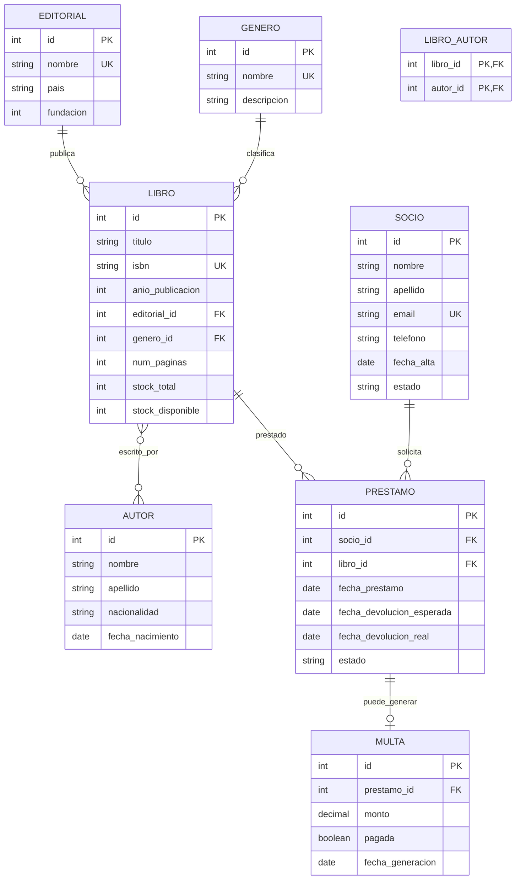

# 🎨 Diseño del Sistema de Biblioteca

## 📋 Análisis de requisitos

### Entidades identificadas

| Entidad | Descripción |
|---------|-------------|
| `libros` | Libros de la biblioteca |
| `autores` | Autores de libros |
| `libro_autor` | Relación N:M entre libros y autores |
| `editoriales` | Editoriales de los libros |
| `generos` | Categorías/géneros de libros |
| `socios` | Personas registradas |
| `prestamos` | Préstamos de libros |
| `multas` | Multas por retrasos |

### Atributos por entidad

**libros:**
- id (PK)
- titulo (NOT NULL)
- isbn (UNIQUE)
- anio_publicacion
- editorial_id (FK)
- genero_id (FK)
- num_paginas
- stock_total (ejemplares totales)
- stock_disponible

**autores:**
- id (PK)
- nombre
- apellido
- nacionalidad
- fecha_nacimiento

**editoriales:**
- id (PK)
- nombre (UNIQUE)
- pais
- fundacion

**generos:**
- id (PK)
- nombre (UNIQUE)
- descripcion

**socios:**
- id (PK)
- nombre
- apellido
- email (UNIQUE)
- telefono
- fecha_alta
- estado ('activo','suspendido','baja')

**prestamos:**
- id (PK)
- socio_id (FK)
- libro_id (FK)
- fecha_prestamo
- fecha_devolucion_esperada
- fecha_devolucion_real (NULL si no devuelto)
- estado ('prestado','devuelto','vencido')

**multas:**
- id (PK)
- prestamo_id (FK, UNIQUE)
- monto
- pagada (BOOLEAN)
- fecha_generacion

## 📐 Diagrama ER

## 🔄 Justificación del diseño

### Decisión 1: N:M libro-autor
Un libro puede tener varios autores, un autor varios libros → tabla intermedia `libro_autor`.

### Decisión 2: Stock desnormalizado
`stock_total` y `stock_disponible` son columnas que se actualizan con triggers. Mejora rendimiento vs `COUNT` de préstamos activos.

### Decisión 3: Estado de préstamo
`estado` permite filtrar rápido sin calcular por fechas.

### Decisión 4: Multa separada
Un préstamo puede generar 0 o 1 multa (relación 1:1 opcional). Se separa para mantener historial de pagos.

### Decisión 5: Estados con CHECK
`estado` limitado a valores específicos:
- Socios: `activo`, `suspendido`, `baja`
- Préstamos: `prestado`, `devuelto`, `vencido`

## ✅ Normalización

### 1FN
Todos los campos son atómicos. No hay listas en celdas.

### 2FN
No hay dependencias parciales. Las tablas con PK compuesta (`libro_autor`) solo tienen los IDs.

### 3FN
No hay dependencias transitivas:
- `editorial.nombre` no está en `libros`, sino en `editoriales`
- `genero.nombre` no está en `libros`, sino en `generos`
- Autor separado de libro

## 📊 Índices planificados

| Índice | Tabla | Columnas | Razón |
|--------|-------|----------|-------|
| `idx_libros_titulo` | libros | titulo | Búsquedas por título |
| `idx_libros_isbn` | libros | isbn | UNIQUE (ya implícito) |
| `idx_libros_genero` | libros | genero_id | Filtrar por género |
| `idx_prestamos_socio` | prestamos | socio_id | Historial del socio |
| `idx_prestamos_libro` | prestamos | libro_id | Historial del libro |
| `idx_prestamos_estado` | prestamos | estado | Préstamos activos/vencidos |
| `idx_socios_email` | socios | email | UNIQUE (ya implícito) |
| `idx_socios_estado` | socios | estado | Socios activos |

## 🎯 Casos de uso (consultas clave)

1. ¿Qué libros están disponibles?
2. ¿Qué libros tiene prestado el socio X?
3. ¿Qué préstamos están vencidos?
4. Top 10 libros más prestados
5. Top 10 socios más activos
6. Ingresos por multas del mes
7. Libros por género
8. Autores con más obras
9. Préstamos por mes
10. Socios con multas sin pagar