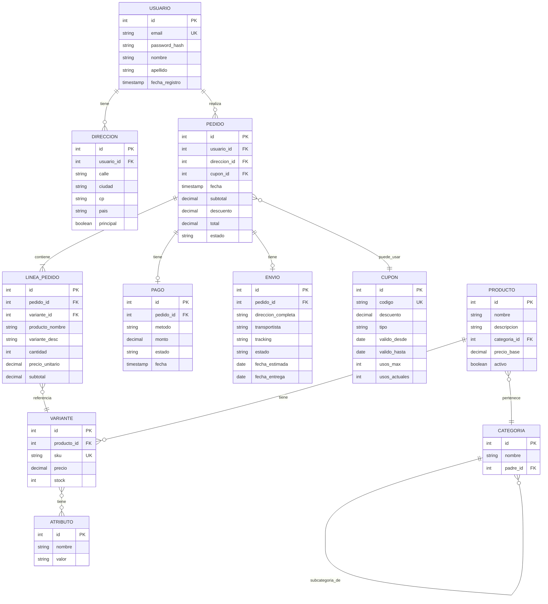

# 🎨 Diseño del E-commerce

## 📋 Entidades principales

| Entidad | Descripción |
|---------|-------------|
| `usuarios` | Clientes registrados |
| `direcciones` | Direcciones de envío |
| `categorias` | Jerarquía de categorías |
| `productos` | Productos base |
| `variantes` | Variantes (talla, color) |
| `atributos` | Tipos de atributo (talla, color) |
| `variante_atributo` | Valores por variante |
| `cupones` | Descuentos |
| `pedidos` | Órdenes de compra |
| `lineas_pedido` | Detalle del pedido |
| `pagos` | Registro de pagos |
| `envios` | Info de envío |

## 📐 Diagrama ER



## 🎯 Decisiones de diseño

### 1. Producto vs Variante
Un producto (ej: "Camiseta") tiene variantes (talla S roja, talla M azul).

**Ventajas:**
- Stock por variante
- Precio por variante
- SKU único

### 2. Snapshot en líneas de pedido
`linea_pedido` guarda `producto_nombre`, `variante_desc`, `precio_unitario` al momento de la compra.

**Razón:** si el producto cambia de nombre o precio después, el pedido histórico queda intacto.

### 3. Categorías jerárquicas
`padre_id` autorreferencial. Permite árbol infinito: Ropa > Hombre > Camisetas.

### 4. Cupones con límites
`usos_max` y `usos_actuales` controlan cuántas veces se puede usar. La validación es transaccional.

### 5. Estados del pedido
```
pendiente → pagado → preparando → enviado → entregado
          ↘ cancelado
```

### 6. Carrito en Redis
El carrito es temporal → Redis con TTL de 7 días.

## 🗄️ Carrito con Redis

### Estructura

```
cart:{usuario_id}  →  Hash
  ├── variante:123:cantidad → 2
  ├── variante:456:cantidad → 1
  └── ...

cart:{usuario_id}:meta  →  Hash
  ├── cupon → "VERANO24"
  └── actualizado → "2024-03-15T10:30:00"
```

### Operaciones

```redis
# Añadir producto
HSET cart:1 variante:123:cantidad 2
HSET cart:1 variante:456:cantidad 1

# Ver carrito
HGETALL cart:1

# Actualizar cantidad
HSET cart:1 variante:123:cantidad 3

# Eliminar
HDEL cart:1 variante:456:cantidad

# Aplicar cupón
HSET cart:1:meta cupon "VERANO24"

# Vaciar
DEL cart:1 cart:1:meta

# TTL de 7 días
EXPIRE cart:1 604800
```

### Flujo completo

1. Usuario añade producto → `HSET cart:1 variante:123:cantidad 1`
2. Al consultar, se hace `HGETALL` y se cruza con PostgreSQL para precios
3. Al pagar:
   - `BEGIN`
   - Crear pedido
   - Copiar líneas
   - `DEL cart:1`
   - `COMMIT`

## 📊 Índices planificados

| Índice | Tabla | Uso |
|--------|-------|-----|
| `idx_pedidos_usuario` | pedidos | Historial del usuario |
| `idx_pedidos_fecha` | pedidos | Reportes por fecha |
| `idx_pedidos_estado` | pedidos | Filtrar por estado |
| `idx_lineas_pedido` | lineas_pedido | Ver detalle |
| `idx_variantes_producto` | variantes | Variantes de producto |
| `idx_variantes_stock` | variantes | Productos con bajo stock |
| `idx_productos_categoria` | productos | Filtrar por categoría |

## 🎯 Consultas clave

1. Carrito actual de un usuario
2. Productos más vendidos
3. Ingresos por mes
4. Clientes top
5. Productos con bajo stock
6. Tasa de conversión (pedidos / carritos)
7. Ticket promedio
8. Categorías más rentables