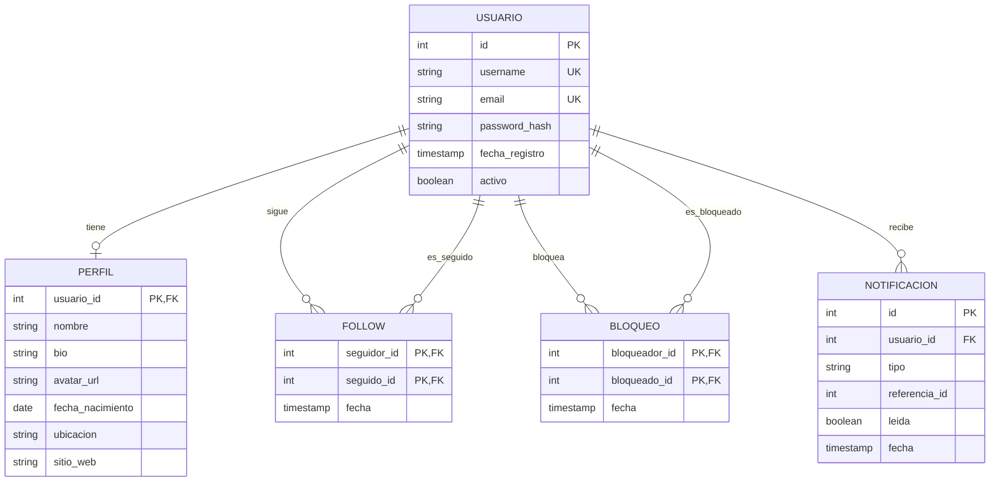

# 🎨 Diseño de la Red Social

## 📋 Análisis por componente

### 1. PostgreSQL: usuarios y relaciones

**Tablas:**
- `usuarios` — cuenta y perfil básico
- `perfiles` — info extendida (1:1)
- `follows` — relaciones N:M
- `bloqueos` — usuarios bloqueados
- `notificaciones` — eventos
- `sesiones` (o en Redis)

**Por qué SQL:**
- Integridad referencial
- Transacciones para follows/bloqueos
- Consultas con JOINs complejos

### 2. MongoDB: contenido

**Colecciones:**
- `posts` — publicaciones
- `comentarios` — comentarios
- `mensajes` — chat

**Por qué NoSQL:**
- Estructura variable (posts con/sin imágenes, ubicación, etc.)
- Escala horizontal
- Documentos autocontenidos

### 3. Redis: caché y tiempo real

**Estructuras:**
- `feed:{usuario_id}` — List con IDs de posts
- `likes:{post_id}` — Set con user_ids
- `views:{post_id}` — String con contador
- `sesion:{token}` — Hash con datos de sesión
- `online:{usuario_id}` — String con timestamp

### 4. Neo4j (opcional): grafo social

**Nodos:** usuarios
**Relaciones:** FOLLOWS, LIKES, COMMENTED

**Uso:** "amigos de amigos", recomendaciones, influencer detection.

## 📐 Diagrama: PostgreSQL



## 📐 Estructura: MongoDB

### Colección `posts`

```javascript
{
    _id: ObjectId(),
    usuario_id: 1,
    contenido: "Texto del post...",
    imagenes: [
        { url: "https://...", alt: "descripción" }
    ],
    hashtags: ["#nosql", "#mongodb"],
    menciones: [2, 3],           // user_ids
    ubicacion: {
        nombre: "Madrid",
        lat: 40.4168,
        lng: -3.7038
    },
    visibilidad: "publico",      // publico | seguidores | privado
    stats: {
        likes: 42,
        comentarios: 8,
        compartidos: 3
    },
    editado: false,
    fecha: ISODate("2024-03-15T10:30:00Z"),
    fecha_edicion: null
}
```

**Índices:**
```javascript
db.posts.createIndex({ usuario_id: 1, fecha: -1 });
db.posts.createIndex({ hashtags: 1 });
db.posts.createIndex({ fecha: -1 });
db.posts.createIndex({ "ubicacion.nombre": 1 });
```

### Colección `comentarios`

```javascript
{
    _id: ObjectId(),
    post_id: ObjectId(),
    usuario_id: 1,
    contenido: "Buen post!",
    padre_id: null,              // para respuestas
    likes: 5,
    fecha: ISODate()
}
```

### Colección `mensajes`

```javascript
{
    _id: ObjectId(),
    conversacion_id: ObjectId(),
    emisor_id: 1,
    receptor_id: 2,
    contenido: "Hola!",
    leido: false,
    fecha: ISODate()
}
```

## 🎯 Decisiones de diseño

### 1. Contadores: ¿en Mongo o Redis?

**Opción A:** Contadores en el documento del post (`stats.likes`)
- ✅ Una sola consulta trae todo
- ❌ Escrituras frecuentes en el mismo documento (hot doc)

**Opción B:** Contadores en Redis
- ✅ Ultra rápido (`INCR`)
- ✅ No bloquea Mongo
- ❌ Se pierden si Redis falla (mitigable con persistencia)

**Decisión:** **Ambos**. Redis para tiempo real, sincronización periódica a Mongo.

### 2. Feed: ¿push o pull?

**Pull (fan-out on read):**
```python
def get_feed(user_id):
    # Obtener a quién sigue
    following = get_following(user_id)
    # Buscar sus posts
    posts = db.posts.find({"usuario_id": {"$in": following}}).sort("fecha", -1)
    return posts
```
- ✅ Simple
- ❌ Lento con muchos seguidos

**Push (fan-out on write):**
```python
def publicar_post(user_id, contenido):
    post_id = db.posts.insert_one({...}).inserted_id
    # Escribir en el feed de cada seguidor
    seguidores = get_followers(user_id)
    for seguidor in seguidores:
        redis.lpush(f"feed:{seguidor}", post_id)
        redis.ltrim(f"feed:{seguidor}", 0, 999)  # solo 1000
```
- ✅ Lectura instantánea
- ❌ Costoso al escribir si tienes millones de seguidores

**Decisión:** **Híbrido**.
- Usuarios normales (< 10k seguidores): push
- Celebridades: pull (los lee al vuelo)

### 3. Sesiones: Redis vs JWT

**Redis:**
- Puedes invalidar sesiones al instante
- Ocupa memoria
- Requiere consulta a Redis

**JWT:**
- Stateless
- No se puede invalidar hasta expirar
- Más rápido

**Decisión:** Redis para apps que necesitan logout instantáneo.

## 🔄 Flujos clave

### Publicar un post

```
1. Validar usuario (Redis: sesión)
2. Insertar en MongoDB (posts)
3. Redis: LPUSH feed:{cada_seguidor} post_id
4. PostgreSQL: INSERT notificaciones (opcional)
5. Redis: INCR stats:user:{user_id}:posts
```

### Dar like

```
1. Redis: SADD likes:{post_id} {user_id}
2. Redis: INCR stats:post:{post_id}:likes
3. PostgreSQL: INSERT notificacion (al autor)
4. Job nocturno: sincronizar contadores a MongoDB
```

### Ver feed

```
1. Redis: LRANGE feed:{user_id} 0 20  → post_ids
2. MongoDB: find({_id: {$in: post_ids}})
3. Redis: MGET stats:post:{id}:likes para contadores actualizados
4. Enriquecer con datos de autores (PostgreSQL o cache)
```

## 🎯 Índices planificados

### PostgreSQL
| Índice | Tabla | Uso |
|--------|-------|-----|
| `idx_follows_seguidor` | follows | A quién sigue |
| `idx_follows_seguido` | follows | Quién le sigue |
| `idx_notif_usuario_leida` | notificaciones | Notif no leídas |

### MongoDB
| Índice | Uso |
|--------|-----|
| `{usuario_id: 1, fecha: -1}` | Posts de un usuario |
| `{hashtags: 1}` | Buscar por hashtag |
| `{fecha: -1}` | Feed global |

### Redis
- `feed:{id}` — List
- `likes:{id}` — Set
- `stats:post:{id}:likes` — String
- `online:{id}` — String con TTL

## ✅ Checklist de arquitectura

- [ ] Usuarios en PostgreSQL (ACID)
- [ ] Posts en MongoDB (flexibilidad)
- [ ] Feed cacheado en Redis
- [ ] Contadores en Redis + sync a Mongo
- [ ] Sesiones en Redis
- [ ] Presencia online en Redis
- [ ] Notificaciones en PostgreSQL
- [ ] Búsqueda en Elasticsearch (opcional)