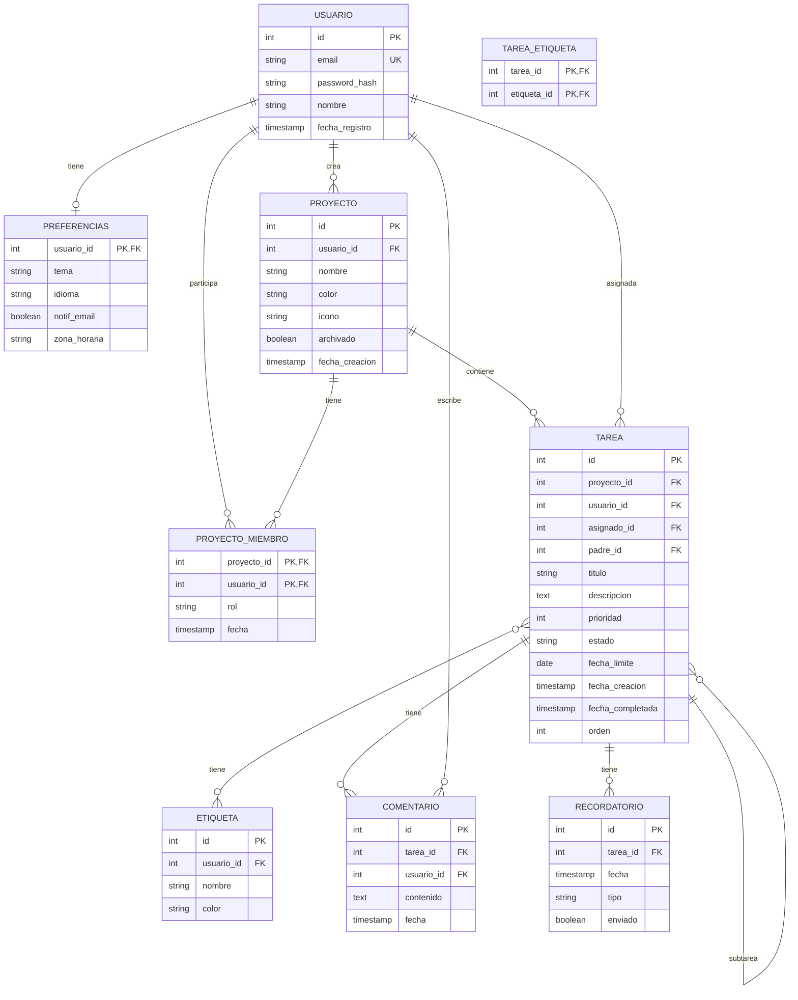

# 🎨 Diseño de la API de Tareas

## 📋 Entidades

| Entidad | Descripción |
|---------|-------------|
| `usuarios` | Cuentas |
| `preferencias` | Config del usuario |
| `proyectos` | Agrupadores |
| `proyecto_miembros` | Compartir proyectos |
| `tareas` | Tareas |
| `etiquetas` | Tags |
| `tarea_etiqueta` | N:M |
| `comentarios` | Comentarios en tareas |
| `recordatorios` | Notificaciones programadas |
| `actividad` | Log de cambios |

## 📐 Diagrama ER



## 🎯 Decisiones de diseño

### 1. Subtareas con `padre_id`
Autorreferencial. Permite jerarquía infinita.

### 2. `asignado_id` vs `usuario_id`
- `usuario_id`: quién creó la tarea
- `asignado_id`: quién la va a hacer

Pueden ser distintos si compartes el proyecto.

### 3. Orden manual
`orden INTEGER` permite reordenar tareas arrastrando (drag and drop).

### 4. Estados
`pendiente`, `en_progreso`, `completada`, `archivada`.

### 5. Prioridad 1-4
Como en Todoist: 1 = urgente, 4 = sin prioridad.

### 6. Actividad
Tabla `actividad` registra cambios (auditoría). Útil para colaboración.

## 🎯 Consultas por endpoint

| Endpoint | Consulta clave |
|----------|----------------|
| `GET /tasks` | Listar tareas con filtros + paginación |
| `GET /tasks/:id` | Detalle con subtareas, etiquetas, comentarios |
| `GET /projects` | Proyectos del usuario (propios + compartidos) |
| `GET /tasks?q=texto` | Full-text search |
| `GET /tasks/today` | Vencen hoy |
| `GET /tasks/upcoming` | Vencen esta semana |
| `POST /tasks` | Crear tarea |
| `PATCH /tasks/:id` | Actualizar parcialmente |
| `DELETE /tasks/:id` | Borrar (con cascade a subtareas) |

## 🎯 Filtros típicos

```
GET /tasks?
    proyecto_id=1&
    estado=pendiente&
    prioridad=1,2&
    etiqueta=urgente&
    vencimiento=2024-03-15&
    q=comprar&
    orden=fecha_limite&
    orden_dir=asc&
    page=1&
    limit=20
```

## 📊 Índices planificados

| Índice | Uso |
|--------|-----|
| `idx_tareas_proyecto` | Listar por proyecto |
| `idx_tareas_padre` | Subtareas |
| `idx_tareas_fecha_limite` | Vencen pronto |
| `idx_tareas_estado_prioridad` | Filtros comunes |
| `idx_tareas_asignado` | "Mis tareas" |
| `idx_tareas_titulo_fts` | Full-text (GIN) |
| `idx_etiquetas_usuario` | Etiquetas del usuario |
| `idx_proyecto_miembro_usuario` | Proyectos compartidos conmigo |

## 🎯 Índice full-text

```sql
CREATE INDEX idx_tareas_fts ON tareas 
USING GIN(to_tsvector('spanish', titulo || ' ' || COALESCE(descripcion, '')));
```

Permite `WHERE to_tsvector('spanish', titulo || ' ' || descripcion) @@ to_tsquery('comprar')`.

## 🔄 Paginación eficiente

**Offset (simple pero lento con páginas grandes):**
```sql
SELECT * FROM tareas ORDER BY id LIMIT 20 OFFSET 100;
```

**Keyset (rápida siempre):**
```sql
SELECT * FROM tareas 
WHERE id > 100 
ORDER BY id 
LIMIT 20;
```

**Cursor basado en fecha:**
```sql
SELECT * FROM tareas
WHERE (fecha_limite, id) > ('2024-03-15', 100)
ORDER BY fecha_limite, id
LIMIT 20;
```