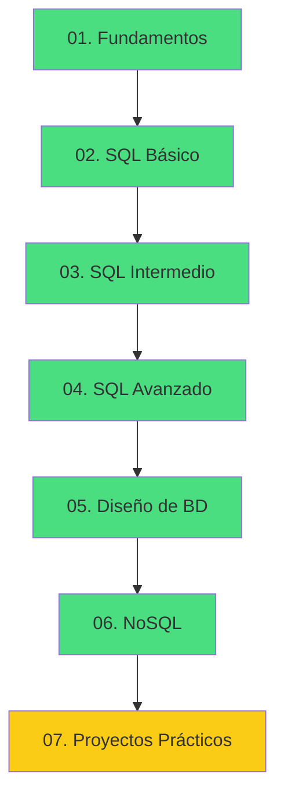

# 📚 Aprendiendo Bases de Datos

<div align="center">


**Repositorio personal para aprender bases de datos desde cero, con teoría, ejemplos y ejercicios.**

[📖 Empezar](#-roadmap) · [🗂️ Índice](#-índice-de-contenidos) · [🚀 Proyectos](#-proyectos-prácticos) · [🤝 Contribuir](#-cómo-contribuir)

</div>

---

## 🎯 Sobre este repositorio

Este repositorio documenta mi viaje aprendiendo bases de datos, desde los conceptos más básicos hasta temas avanzados y proyectos reales. Cada módulo incluye:

- 📘 **Teoría clara** con ejemplos
- 💻 **Código ejecutable** listo para copiar
- 🧪 **Ejercicios** con soluciones ocultas
- 🎯 **Proyectos prácticos** para aplicar lo aprendido

> 💡 **Filosofía:** aprender haciendo. Cada concepto viene con ejemplos reales y ejercicios resueltos.

---

## 🗺️ Roadmap



| Módulo | Tema | Estado | Horas |
|--------|------|--------|-------|
| 01 | [Fundamentos](./01-fundamentos/) | ✅ Completo | 2-3h |
| 02 | [SQL Básico](./02-sql-basico/) | ✅ Completo | 6-8h |
| 03 | [SQL Intermedio](./03-sql-intermedio/) | ✅ Completo | 8-10h |
| 04 | [SQL Avanzado](./04-sql-avanzado/) | ✅ Completo | 10-12h |
| 05 | [Diseño de BD](./05-diseno-bd/) | ✅ Completo | 8-10h |
| 06 | [NoSQL](./06-nosql/) | ✅ Completo | 10-12h |
| 07 | [Proyectos Prácticos](./07-proyectos-practicos/) | 🚧 En progreso | 30-40h |

**Progreso total:** `███████████████░░░ 85%`

---

## 🗂️ Índice de contenidos

<details>
<summary><b>📘 Módulo 01: Fundamentos</b></summary>

- [¿Qué es una base de datos?](./01-fundamentos/01-que-es-una-bd.md)
- [Tipos de bases de datos](./01-fundamentos/02-tipos-de-bd.md)
- [Modelo relacional](./01-fundamentos/03-modelo-relacional.md)
- [Ejercicios](./01-fundamentos/ejercicios/)

</details>

<details>
<summary><b>📗 Módulo 02: SQL Básico</b></summary>

- [SELECT](./02-sql-basico/01-select.md)
- [WHERE](./02-sql-basico/02-where.md)
- [ORDER BY y LIMIT](./02-sql-basico/03-order-by-limit.md)
- [INSERT, UPDATE, DELETE](./02-sql-basico/04-insert-update-delete.md)
- [Ejercicios](./02-sql-basico/ejercicios/)

</details>

<details>
<summary><b>📙 Módulo 03: SQL Intermedio</b></summary>

- [JOINs](./03-sql-intermedio/01-joins.md)
- [GROUP BY y HAVING](./03-sql-intermedio/02-group-by-having.md)
- [Funciones agregadas](./03-sql-intermedio/03-funciones-agregadas.md)
- [Subconsultas](./03-sql-intermedio/04-subconsultas.md)
- [Ejercicios](./03-sql-intermedio/ejercicios/)

</details>

<details>
<summary><b>📕 Módulo 04: SQL Avanzado</b></summary>

- [CTEs (WITH)](./04-sql-avanzado/01-ctes.md)
- [Window Functions](./04-sql-avanzado/02-window-functions.md)
- [CASE y COALESCE](./04-sql-avanzado/03-case-coalesce.md)
- [Índices](./04-sql-avanzado/04-indices.md)
- [Transacciones](./04-sql-avanzado/05-transacciones.md)
- [Vistas y Procedimientos](./04-sql-avanzado/06-vistas-procedimientos.md)
- [Ejercicios](./04-sql-avanzado/ejercicios/)

</details>

<details>
<summary><b>📔 Módulo 05: Diseño de Bases de Datos</b></summary>

- [Proceso de diseño](./05-diseno-bd/01-proceso-diseno.md)
- [Diagramas ER](./05-diseno-bd/02-diagramas-er.md)
- [Normalización](./05-diseno-bd/03-normalizacion.md)
- [Integridad referencial](./05-diseno-bd/04-integridad-referencial.md)
- [Desnormalización](./05-diseno-bd/05-desnormalizacion.md)
- [Ejercicios](./05-diseno-bd/ejercicios/)

</details>

<details>
<summary><b>📒 Módulo 06: NoSQL</b></summary>

- [Introducción a NoSQL](./06-nosql/01-introduccion-nosql.md)
- [Modelado documental](./06-nosql/02-modelado-documental.md)
- [MongoDB](./06-nosql/03-mongodb.md)
- [Redis](./06-nosql/04-redis.md)
- [SQL vs NoSQL](./06-nosql/05-sql-vs-nosql.md)
- [Ejercicios](./06-nosql/ejercicios/)

</details>

<details>
<summary><b>🏗️ Módulo 07: Proyectos Prácticos</b></summary>

- [📚 Sistema de Biblioteca](./07-proyectos-practicos/01-sistema-biblioteca/) — SQL puro
- [🛒 E-commerce](./07-proyectos-practicos/02-ecommerce/) — SQL + Redis
- [👥 Red Social](./07-proyectos-practicos/03-red-social/) — SQL + MongoDB + Redis
- [📝 API de Tareas](./07-proyectos-practicos/04-api-tareas/) — Diseño para API
- [📊 Dashboard Analítico](./07-proyectos-practicos/05-dashboard-analitico/) — Window functions + MVs

</details>

---

## 🚀 Proyectos Prácticos

### 📚 Sistema de Biblioteca
Sistema completo con libros, autores, socios y préstamos.

**Practica:** ER, normalización, FK, constraints, JOINs, reportes, multas.
**Stack:** PostgreSQL / SQLite

[Ver proyecto →](./07-proyectos-practicos/01-sistema-biblioteca/)

---

### 🛒 E-commerce
Sistema con catálogo, carrito, pedidos, cupones y envíos.

**Practica:** Jerarquías, snapshots históricos, estados, Redis para carrito, reportes.
**Stack:** PostgreSQL + Redis

[Ver proyecto →](./07-proyectos-practicos/02-ecommerce/)

---

### 👥 Red Social
Arquitectura políglota con feed, likes, seguidores y mensajería.

**Practica:** Diseño cross-DB, fan-out del feed, contadores en tiempo real.
**Stack:** PostgreSQL + MongoDB + Redis

[Ver proyecto →](./07-proyectos-practicos/03-red-social/)

---

### 📝 API de Tareas
Diseño de BD optimizado para una API REST.

**Practica:** Paginación keyset, full-text, filtros dinámicos, índices.
**Stack:** PostgreSQL

[Ver proyecto →](./07-proyectos-practicos/04-api-tareas/)

---

### 📊 Dashboard Analítico
KPIs, cohortes, RFM, proyecciones y vistas materializadas.

**Practica:** Window functions, CTEs, MVs, particionado, optimización.
**Stack:** PostgreSQL

[Ver proyecto →](./07-proyectos-practicos/05-dashboard-analitico/)

---

## 🛠️ Tecnologías usadas

<div align="center">

| SQL | NoSQL | Herramientas |
|-----|-------|--------------|
|  |  |  |
|  |  |  |
|  | |  |

</div>

---

## ⚡ Quick Start

### 1. Clonar el repositorio

```bash
git clone https://github.com/TU_USUARIO/aprendiendo-bases-de-datos.git
cd aprendiendo-bases-de-datos
```

### 2. Elegir tu entorno

<details>
<summary><b>SQLite (más fácil, sin instalación)</b></summary>

```bash
# Linux/Mac
sqlite3 practica.db

# Windows: descargar de https://sqlite.org/download.html
# O usar online: https://sqliteonline.com/
```

</details>

<details>
<summary><b>PostgreSQL con Docker</b></summary>

```bash
docker run --name pg-practica \
  -e POSTGRES_PASSWORD=pass \
  -p 5432:5432 \
  -d postgres

# Conectar
docker exec -it pg-practica psql -U postgres
```

</details>

<details>
<summary><b>MySQL con Docker</b></summary>

```bash
docker run --name mysql-practica \
  -e MYSQL_ROOT_PASSWORD=pass \
  -p 3306:3306 \
  -d mysql

# Conectar
docker exec -it mysql-practica mysql -uroot -ppass
```

</details>

<details>
<summary><b>MongoDB con Docker</b></summary>

```bash
docker run --name mongo-practica \
  -p 27017:27017 \
  -d mongo:latest

# Conectar
docker exec -it mongo-practica mongosh
```

</details>

<details>
<summary><b>Redis con Docker</b></summary>

```bash
docker run --name redis-practica \
  -p 6379:6379 \
  -d redis:latest

# Conectar
docker exec -it redis-practica redis-cli
```

</details>

### 3. Cargar el dataset de práctica

```bash
# SQLite
sqlite3 practica.db < recursos/datasets/tienda.sql

# PostgreSQL
psql -U postgres -d practica -f recursos/datasets/tienda.sql

# MongoDB
mongosh < recursos/datasets/tienda-nosql.js
```

### 4. Empezar a aprender

Abre el [Módulo 01](./01-fundamentos/) y sigue el orden. Cada carpeta tiene su propio `README.md` con el índice.

---

## 📖 Cómo usar este repositorio

### Para aprender

1. **Lee la teoría** de cada archivo `.md`
2. **Ejecuta los ejemplos** en tu BD
3. **Resuelve los ejercicios** antes de ver las soluciones
4. **Haz los proyectos** para consolidar

### Estructura de cada tema

```
tema/
├── README.md              -- índice
├── 01-concepto.md         -- teoría
├── 02-concepto.md
└── ejercicios/
    ├── README.md
    ├── ejercicios-01.md   -- con soluciones ocultas
    └── ejercicios-02.md   -- desafíos
```

### Convenciones del repositorio

- ✅ Soluciones ocultas con `<details>` (no hagas spoiler)
- ✅ Código SQL en bloques con sintaxis resaltada
- ✅ Diagramas con Mermaid (compatible con GitHub)
- ✅ Ejemplos probados en PostgreSQL, MySQL y SQLite (cuando aplica)

---

## 🎓 Lo que aprenderás

### SQL
- ✅ Consultas básicas y avanzadas
- ✅ JOINs de todo tipo
- ✅ Agregaciones y window functions
- ✅ CTEs y subconsultas
- ✅ Transacciones y ACID
- ✅ Índices y optimización

### Diseño
- ✅ Modelado ER
- ✅ Normalización (1FN, 2FN, 3FN, BCNF)
- ✅ Integridad referencial
- ✅ Desnormalización estratégica

### NoSQL
- ✅ MongoDB y modelado documental
- ✅ Redis y caché
- ✅ Arquitecturas políglotas
- ✅ Cuándo usar cada tecnología

### Práctica
- ✅ 5 proyectos completos
- ✅ Más de 100 ejercicios
- ✅ Reportes y dashboards
- ✅ Optimización de consultas

---

## 📊 Estadísticas del repositorio

<div align="center">

| Métrica | Cantidad |
|---------|----------|
| 📘 Módulos | 7 |
| 📝 Archivos markdown | 60+ |
| 🧪 Ejercicios | 100+ |
| 🎯 Proyectos | 5 |
| 💻 Ejemplos SQL | 400+ |
| ⏱️ Horas estimadas | 75-95h |

</div>

---

## 🤝 Cómo contribuir

Este es un repositorio personal de aprendizaje, pero las sugerencias son bienvenidas:

1. 🐛 **Reporta errores** abriendo un [issue](https://github.com/TU_USUARIO/aprendiendo-bases-de-datos/issues)
2. 💡 **Sugiere mejoras** con un [pull request](https://github.com/TU_USUARIO/aprendiendo-bases-de-datos/pulls)
3. ⭐ **Dale una estrella** si te resulta útil
4. 🔀 **Haz un fork** y adáptalo a tu estilo

### Guía de estilo

- Markdown limpio y consistente
- Ejemplos ejecutables
- Comentarios en español
- Indentación de 4 espacios en SQL

---

## 📚 Recursos recomendados

### Documentación oficial
- [PostgreSQL Docs](https://www.postgresql.org/docs/)
- [MySQL Docs](https://dev.mysql.com/doc/)
- [MongoDB Manual](https://www.mongodb.com/docs/manual/)
- [Redis Docs](https://redis.io/docs/)

### Tutoriales y cursos
- [SQLBolt](https://sqlbolt.com/) — SQL interactivo
- [Use The Index, Luke](https://use-the-index-luke.com/) — Índices
- [MongoDB University](https://learn.mongodb.com/) — Gratis
- [Try Redis](https://try.redis.io/) — Redis interactivo

### Práctica
- [LeetCode Database](https://leetcode.com/problemset/database/)
- [HackerRank SQL](https://www.hackerrank.com/domains/sql)
- [SQLZoo](https://sqlzoo.net/)
- [Window Functions](https://www.windowfunctions.com/)

### Libros
- 📕 *SQL Antipatterns* — Bill Karwin
- 📗 *Designing Data-Intensive Applications* — Martin Kleppmann
- 📘 *Database Design for Mere Mortals* — Michael Hernandez
- 📙 *MongoDB: The Definitive Guide* — Kristina Chodorow

---

## 🗓️ Changelog

<details>
<summary><b>Ver historial de cambios</b></summary>

### [Unreleased]
- 🚧 Módulo 07: Proyectos Prácticos en progreso

### [1.0.0] - 2024
- ✅ Módulo 01: Fundamentos
- ✅ Módulo 02: SQL Básico
- ✅ Módulo 03: SQL Intermedio
- ✅ Módulo 04: SQL Avanzado
- ✅ Módulo 05: Diseño de BD
- ✅ Módulo 06: NoSQL
- ✅ Módulo 07: Proyectos (parcial)

</details>

---

## 📈 Próximos pasos

Después de completar este repositorio, planeo aprender:

- [ ] **ORM:** SQLAlchemy, Prisma, Hibernate
- [ ] **Data Engineering:** dbt, Airflow, Snowflake
- [ ] **Bases de datos distribuidas:** Cassandra, CockroachDB
- [ ] **Búsqueda:** Elasticsearch, OpenSearch
- [ ] **Grafos:** Neo4j, ArangoDB
- [ ] **Series temporales:** InfluxDB, TimescaleDB
- [ ] **Cloud:** RDS, Aurora, DynamoDB, BigQuery

---

## 📄 Licencia

Este proyecto está bajo la licencia MIT. Ver [LICENSE](./LICENSE) para más detalles.

---

## 🙏 Agradecimientos

- A la comunidad de [r/SQL](https://www.reddit.com/r/SQL/) y [r/Database](https://www.reddit.com/r/Database/)
- A los mantenedores de PostgreSQL, MongoDB y Redis por su excelente documentación
- A todos los que comparten conocimiento abiertamente

---

<div align="center">

### ⭐ Si este repositorio te resulta útil, dale una estrella ⭐

**Hecho con ❤️ y mucho ☕ mientras aprendo bases de datos**

[⬆️ Volver arriba](#-aprendiendo-bases-de-datos)

</div>